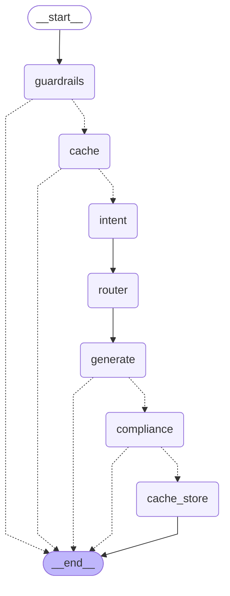

# Governed gateway: pipeline, router and cache

One query goes through six governance stages. Each stage writes one block of the
decision record, and the run stops at the first stage that says so. The order is a
LangGraph state graph; the stages themselves are plain functions.

## The graph

Generated by `python -m gateway.graph`. Solid arrows always run; dotted arrows are
decisions that can end the run early.



| Node | Stage | Code behind it | Ends the run when |
| --- | --- | --- | --- |
| guardrails | 1. Input guardrails | Team A's policy in `config2/` via `gateway/guardrails_adapter.py` | status is `block` |
| cache | 2. Semantic cache | `banking_chatbot/cache.py` via `gateway/cache_adapter.py` | status is `hit` |
| intent | 3. Intent | `banking_chatbot/intent/` via `gateway/intent_adapter.py` | never |
| router | 4. Model tier and cost estimate | `gateway/router.py` | never |
| generate | 5. LLM response | `gateway/llm.py` | the provider returns `error` |
| compliance | 6. Output compliance | `banking_chatbot/compliance*.py` via `gateway/compliance_adapter.py` | status is not `pass` |
| cache_store | store the answer for reuse | `gateway/cache_adapter.py` | always (last node) |

## What each stage really does today

| Stage | State | What is missing |
| --- | --- | --- |
| 1. Guardrails | Working when switched on: one model call per question | The four rules in `config2/prompts.yml` are checked by a Gemini call made by the gateway itself. Team A's `guardrails.py` runs the same rules through NeMo Guardrails, which cannot be installed next to LangGraph 1.2 (it needs `langchain-core` below 0.4) and does not import on Python 3.14, so that file is not used by the pipeline. The check runs on the tier-1 model, not the `gemini-3.5-flash` their config names, because the free tier allows that model 20 requests a day; set `GUARDRAILS_MODEL` to change it. The policy check needs a key and the network, so it is off in simulated workload runs. Masking (`gateway/masking.py`) is local and always on: card numbers, Social Security numbers, account numbers, PINs and passwords are replaced with placeholders such as `[CARD NUMBER]` before any other stage runs, so the policy check, the model and the audit log only see the masked question, and a masked question is still answered. Values written out in words are not masked; the policy check blocks those, and such a blocked question is logged as typed. |
| 2. Cache | Working: exact and semantic | Joohye's approval of using the system prompt as the cache's "source", since non-RAG has no retrieved rows. |
| 3. Intent | Working | Team C's Banking77 model (`banking_chatbot/intent/models/banking77_classifier.joblib`, a TF-IDF plus logistic regression pipeline with 77 labels) labels every question in a few milliseconds. Below 20% confidence it falls back to `general_banking_faq`. Its tier suggestion is recorded in `intent.suggested_tier`; the router does not follow it, and the gateway's default system prompt is still used. |
| 4. Router | Working | Two known misroutes out of 60 labelled queries (`python -m gateway.router_eval data/router_eval.csv`). |
| 5. LLM | Working: simulated and live Gemini | |
| 6. Compliance | Local checks enforced | The format, sensitive-data and contact validators run on every answer. The semantic reviewer does not: it requires retrieved references, which non-RAG does not have. `output_compliance.unreviewed` lists the rules that were therefore not checked. |

A failed compliance check withholds the answer: the customer is told it was blocked and
why (for example, that it contained sensitive information), the rejected text is removed
from the decision record, and it is never cached.

Every record ends with `response`, the text the customer was shown: the answer when the
run ended `answered` or `cached`, the reason when it ended `blocked`, and an apology with
the provider's message when it ended `error`. `gateway/response.py` builds it.

## Three files, three jobs

- `gateway/stages.py`: the stage functions, including the stubs teammates replace.
  Keep the function name and return type, change the body.
- `gateway/graph.py`: the wiring only. The state dictionary (`GatewayState`), one node
  per stage, four edge functions for the early exits, and the compiled `GRAPH`.
- `gateway/pipeline.py`: `process(query, ...)`, the single entry point. It runs the
  graph and turns the final state into a `DecisionRecord` (`gateway/schema.py`), which
  is also what the audit log stores, one JSON line per request.

The router (`gateway/router.py`), providers (`gateway/llm.py`) and tier prices
(`config/tiers.yaml`) have no LangGraph in them and are tested on their own.

## Running it

```bash
source .venv/bin/activate
python -m gateway "How do I reset my PIN?"                     # simulated, logged to var/decisions.jsonl
python -m gateway "How do I reset my PIN?" --cache semantic    # run twice: second is a cache hit
python -m gateway "Compare APR on both cards" --intent investment_question --live   # needs GEMINI_API_KEY in .env
python -m gateway "My card is 4111 1111 1111 1111" --guardrails --live   # the number is masked first, then the input policy runs
python -m gateway.workload run data/workload_sample.csv         # 30 queries, simulated
python -m gateway.workload summarize var/decisions.jsonl       # cost vs baseline from the audit log
python -m streamlit run gateway_app.py --server.port 8502       # the demo page: the graph lights up node by node
python -m unittest discover -s tests -q
python scripts/intent_live_check.py                             # Team C's own check: needs litellm, the model file, and makes live calls
```

## Watching a run on the demo page

`process()` takes an optional `on_step(node_name, state)` callback. It runs the
graph with `GRAPH.stream(..., stream_mode="updates")` instead of `invoke()`, so
each node's update arrives as soon as that node finishes; the final state, and
therefore the record, is the same either way. The demo page passes a callback
that redraws the page after every node.

`gateway/walkthrough.py` turns those events into what the page shows:

- `diagram(visited, finished=...)` builds a Mermaid flowchart from
  `GRAPH.get_graph()`, the compiled graph itself, so it cannot drift from the
  wiring. Visited nodes are green, the node that is running is amber, the
  others grey; the edges the run took are drawn thick, and every conditional
  exit carries its meaning (`allow`/`block`, `miss`/`hit`, `generated`/`error`,
  `pass`/`fail`).
- `narrate(node, state)` writes one sentence per node from the decision it just
  made, ending with what runs next or that the run stopped.

The page renders the Mermaid text with mermaid.js from a CDN inside a small
iframe (`st.iframe`); offline, it falls back to showing the diagram as text.
The "Pause between graph steps" slider in the sidebar only slows the drawing
down so each step is visible; it does not touch the pipeline.

## Plugging a stage in

1. Open `gateway/stages.py` and replace the body of your function. Return the dataclass
   named in its signature; the fields are in `gateway/schema.py`. If your code lives in
   `banking_chatbot/`, put the translation between your types and that dataclass in a
   small `gateway/<stage>_adapter.py`, as cache, intent and compliance do.
2. Run the tests. `tests/test_graph.py` already exercises the block, cache-hit, error and
   compliance-fail exits, so a stage that ends the run is covered.
3. Nothing in `graph.py` changes unless the *order* changes.

## Changing the order

A new arrow is one line in `build_graph()`. A loop, for example "compliance failed,
retry on the next tier up", is a conditional edge from `compliance` back to `router`
plus a retry counter in the state. The nodes do not change. That is the reason the
pipeline is a graph rather than a function.
