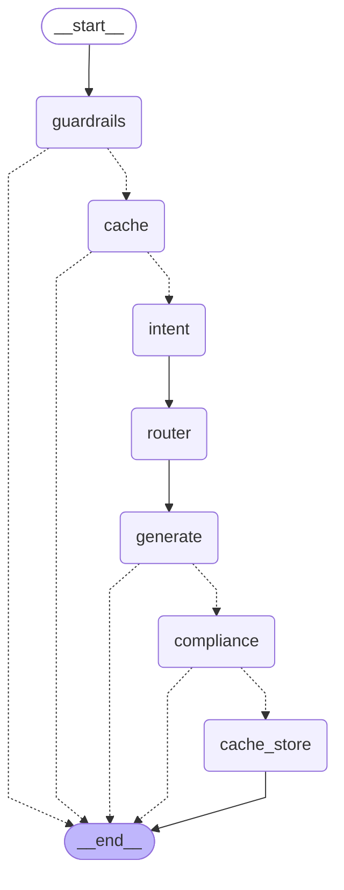

# Governed gateway: pipeline, router and cache

One query goes through six governance stages. Each stage writes one block of the
decision record, and the run stops at the first stage that says so. The order is a
LangGraph state graph; the stages themselves are plain functions.

## The graph

Generated by `python -m gateway.graph`. Solid arrows always run; dotted arrows are
decisions that can end the run early.



| Node | Stage | Owner | Ends the run when |
| --- | --- | --- | --- |
| guardrails | 1. Input guardrails | Team A | status is `block` |
| cache | 2. Semantic cache | Team B (adapter: `gateway/cache_adapter.py`) | status is `hit` |
| intent | 3. Intent and system prompt | Team C | never |
| router | 4. Model tier and cost estimate | us | never |
| generate | 5. LLM response | us | the provider returns `error` |
| compliance | 6. Output compliance | Team D | status is not `pass` |
| cache_store | store the answer for reuse | us | always (last node) |

## Three files, three jobs

- `gateway/stages.py`: the stage functions, including the stubs teammates replace.
  Keep the function name and return type, change the body.
- `gateway/graph.py`: the wiring only. The state dictionary (`GatewayState`), one node
  per stage, four edge functions for the early exits, and the compiled `GRAPH`.
- `gateway/pipeline.py`: `process(query, ...)`, the single entry point. It runs the
  graph and turns the final state into a `DecisionRecord` (`gateway/schema.py`), which
  is also what the audit log stores, one JSON line per request.

The router (`gateway/router.py`), providers (`gateway/llm.py`) and tier prices
(`config/tiers.yaml`) have no LangGraph in them and are tested on their own.

## Running it

```bash
source .venv/bin/activate
python -m gateway "How do I reset my PIN?"                     # simulated, logged to var/decisions.jsonl
python -m gateway "How do I reset my PIN?" --cache semantic    # run twice: second is a cache hit
python -m gateway "Compare APR on both cards" --intent investment_question --live   # needs GEMINI_API_KEY in .env
python -m gateway.workload run data/workload_sample.csv         # 30 queries, simulated
python -m gateway.workload summarize var/decisions.jsonl       # cost vs baseline from the audit log
python -m streamlit run gateway_app.py --server.port 8502       # the demo page
python -m unittest discover -s tests -q
```

## Plugging a stage in

1. Open `gateway/stages.py` and replace the body of your function. Return the dataclass
   named in its signature; the fields are in `gateway/schema.py`.
2. Run the tests. `tests/test_graph.py` already exercises the block, cache-hit, error and
   compliance-fail exits, so a stage that ends the run is covered.
3. Nothing in `graph.py` changes unless the *order* changes.

## Changing the order

A new arrow is one line in `build_graph()`. A loop, for example "compliance failed,
retry on the next tier up", is a conditional edge from `compliance` back to `router`
plus a retry counter in the state. The nodes do not change. That is the reason the
pipeline is a graph rather than a function.
